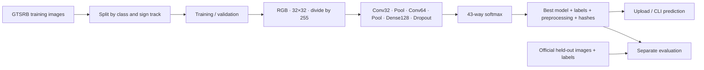

# RoadSignNet
### Traffic Sign Classification Using Deep Learning and Computer Vision

**Project owner:** Kanishkar B · **GitHub:** [Kanishkar843](https://github.com/Kanishkar843)

**Register number:** 722824148043

**Report:** Kanishkar B — RoadSignNet DLCV project report

An educational, end-to-end classifier for **one cropped traffic sign**. RoadSignNet uses a compact TensorFlow/Keras CNN and the **43 classes of GTSRB**, with consistent **32 × 32 RGB** preprocessing. Includes model training, leakage checks, held-out evaluation, command-line prediction, and a Streamlit upload interface.

> **Status:** Implementation provided; CPU integration checks use synthetic fixtures. No pretrained GTSRB model is bundled and benchmark accuracy has not been measured. Download the official dataset and run training before classifying real signs. Synthetic test results are not recognition-performance evidence.

## Quick start

Python **3.11–3.13** (tested with 3.12); 8 GB RAM recommended. A GPU is optional.

```bash
git clone https://github.com/Kanishkar843/RoadSignNet.git
cd RoadSignNet
python -m venv .venv
source .venv/bin/activate  # Windows PowerShell: .venv\Scripts\Activate.ps1
python -m pip install -r requirements.txt
```

Download GTSRB training images, official test images and their ground-truth CSV. Follow [dataset setup](docs/DATASET.md); the dataset is not included in this repository.

```bash
# 1. Train and select a checkpoint using only training/validation data.
python -m roadsignnet.train --data-dir data --output models/roadsignnet --epochs 20

# 2. Evaluate the selected model on the official held-out test data.
python -m roadsignnet.evaluate --data-dir data --test-csv data/GT-final_test.csv --model-dir models/roadsignnet --output results/held-out

# 3. Start the image-upload application.
streamlit run app.py
```

For the common Kaggle folder layout, use `--test-csv data/Test.csv`. Training requires at least two distinct sign tracks per class. Always use an empty output folder for a new experiment.

CLI prediction and optional CSV logging:

```bash
python -m roadsignnet.predict path/to/sign.png --model-dir models/roadsignnet --threshold 0.70 --log results/predictions.csv
```

The UI reads `models/roadsignnet` by default; set `ROADSIGNNET_MODEL_DIR` to choose a different bundle. It shows an explicit setup message until trained weights exist. Uploads are processed in memory; prediction downloads contain metadata, not the uploaded image.

## Architecture



- **CNN:** two 3×3 convolution blocks (32/64 filters), ReLU, max pooling, dense 128, dropout 0.5, 43-way softmax.
- **Training:** Adam, sparse categorical cross-entropy, seeded execution, early stopping and best validation-loss checkpoint.
- **Augmentation:** modest rotation, translation, zoom and brightness, active only during training; no horizontal flips.
- **Split:** per-class sign-track holdout, rather than splitting neighboring frames of the same sign. Test labels never enter the training command.
- **Audit:** cross-partition duplicate byte hashes and track checks; saved split manifest; checksum validation before evaluation/inference.
- **Evaluation:** accuracy, all-43-class macro precision/recall/F1, per-class metrics, confusion matrix, frequent confusions and warm single-image inference timing.
- **Prediction:** highest-scoring label, top three alternatives, confidence threshold and optional CSV records.

## Outputs

| Location | Contents |
|---|---|
| `models/roadsignnet/` | `model.keras`, `metadata.json`, `split_manifest.json`, `history.csv`, `training_curves.png` |
| `results/held-out/` | Metrics JSON, classification report JSON/CSV, confusion matrix CSV/PNG, prediction CSV, test manifest |
| UI prediction download | Class ID/name, scores, review status, timestamp, inference timing |

Keep the complete model bundle together. Do not rename labels or edit preprocessing metadata independently of model weights. Dataset/model/evaluation artifacts are ignored by Git by default.

## Validation

```bash
python -m pip install pytest==8.4.2 ruff==0.14.3
python -m ruff check .
python -m pytest -q
```

Tests cover preprocessing, label mapping, sign-track separation, duplicate-image leakage, invalid input, score validation, one CPU training epoch, save/reload, held-out evaluation generation, and the application's initial state. They deliberately use tiny synthetic fixtures so they do not download a dataset or imply benchmark accuracy. See [validation evidence](docs/VALIDATION.md).

## Report alignment and provenance

This is an **AI-assisted adaptation and extension** of [Vishal Kumar's MIT-licensed baseline](https://github.com/Vishal-kr6/traffic-signs-classification-cnn), prepared for Kanishkar B's report. It is not represented as independently authored baseline research. The original source and license are preserved under `third_party/upstream/`; the root MIT notice is retained. Added pipeline, interface, tests and documentation are described in [ATTRIBUTION.md](ATTRIBUTION.md).

- [Repository comparison](docs/REPOSITORY_COMPARISON.md)
- [Report-to-code mapping](docs/REPORT_ALIGNMENT.md)
- [Dataset preparation](docs/DATASET.md)
- [Validation and remaining experiment](docs/VALIDATION.md)

## Limits

RoadSignNet does not detect signs in full road scenes. It always scores known GTSRB classes, so an unrelated image or unfamiliar sign can receive a high score. Confidence is not a calibrated correctness probability or an out-of-distribution detector. Review every prediction. This is an educational prototype, not a driving or vehicle-control system.

## References

- Stallkamp et al., *The German Traffic Sign Recognition Benchmark: A Multi-Class Classification Competition*, IJCNN 2011.
- [Official GTSRB benchmark](https://benchmark.ini.rub.de/gtsrb_dataset.html)
- [TensorFlow image classification](https://www.tensorflow.org/tutorials/images/classification)
- [scikit-learn classification metrics](https://scikit-learn.org/stable/modules/model_evaluation.html)
